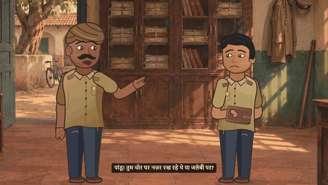
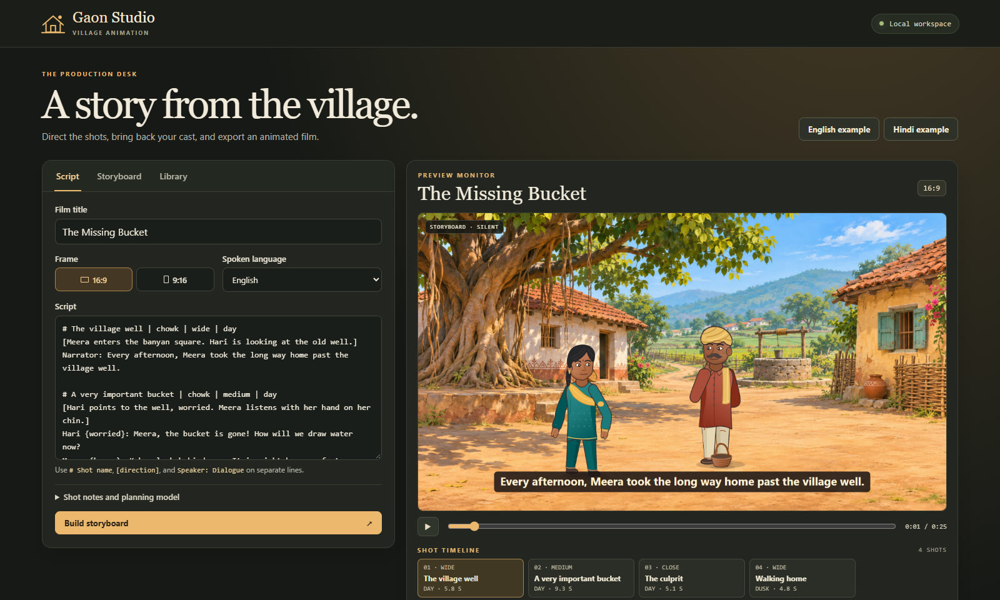
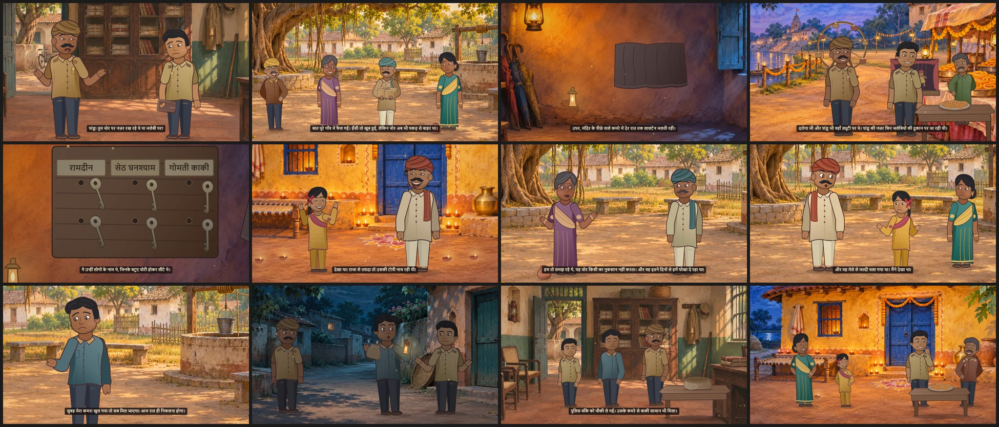
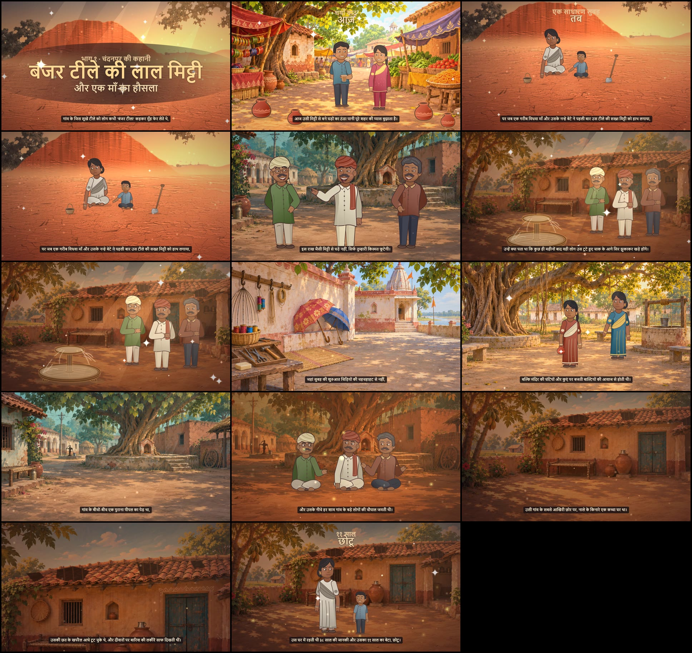
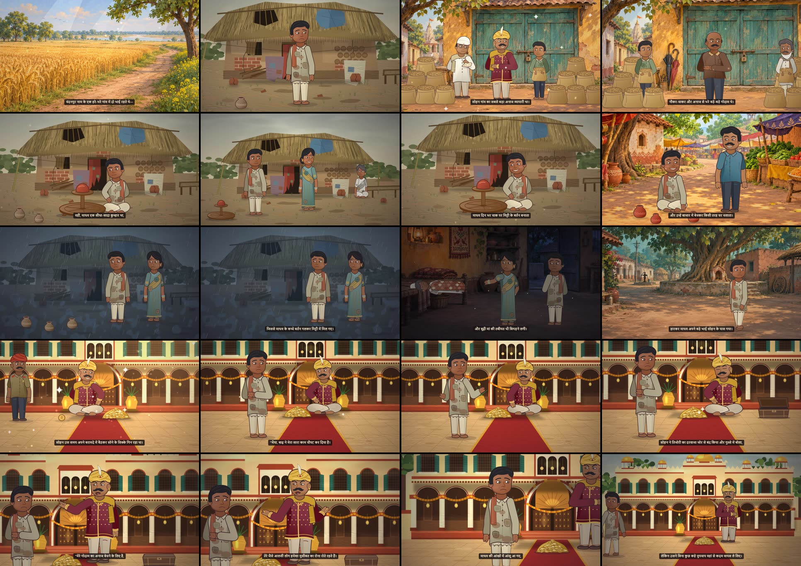
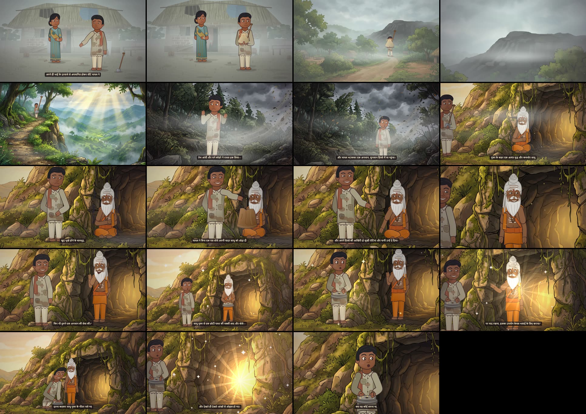
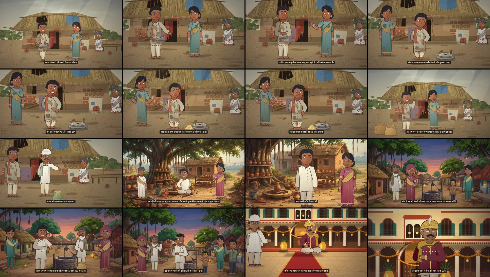
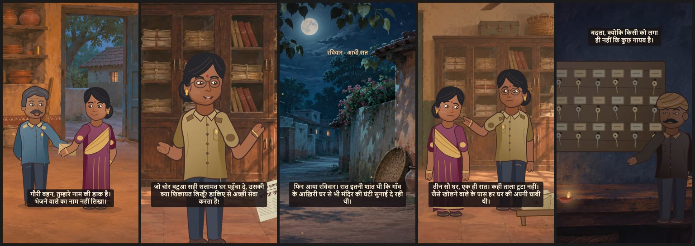

# Gaon Studio

Gaon Studio turns a script and shot directions into a 2D Indian village animation. It uses an original canvas renderer for the cast, props, and scenery, a language model for shot planning, VoiceStudio for local speech, and FFmpeg for the final film.

<p align="center">
  
</p>

## What it produces

You write a script like this:

```text
# The village well | chowk | wide | day
[Meera enters the banyan square. Hari is looking at the old well.]
Narrator: Every afternoon, Meera took the long way home past the village well.
Hari {worried}: Meera, the bucket is gone! How will we draw water now?
```

Gaon Studio turns it into a voiced, captioned MP4 (with an SRT file and an editable storyboard JSON). It handles framing, character rigs, lip movement, backgrounds, sound effects, and music ducking.

| Sample | Format | Watch |
| --- | --- | --- |
| *The Missing Bucket*, the bundled English demo (`npm run demo`) | 16:9 · 720p · 21 s · offline voice | [▶ sample-english-demo.mp4](docs/media/sample-english-demo.mp4) |
| *Bargadpur, Part 2* (Hindi episode), a 40 s excerpt from a 16-minute film | 16:9 · 1080p (excerpt at 720p) · VoiceStudio | [▶ sample-bargadpur-clip.mp4](docs/media/sample-bargadpur-clip.mp4) |

### The studio



### Contact sheet: *Bargadpur, Part 2* (16:9, Hindi)

Twelve frames sampled evenly across the 16-minute episode. They show recurring characters, interiors, a night lane, a Diwali fair, and insert shots.



### Contact sheet: *बंजर टीले की लाल मिट्टी*, Part 1 (16:9, Hindi, with sparkle effects)

A 1 min 48 s opening chapter at 1080p: a shimmering title card, a barren red mound, light rays, drifting gold sparkles, and a synthesized bansuri and tanpura score. Scripts, build tools and voice notes are in [productions/banjar-teela-part-1/](productions/banjar-teela-part-1/) and [docs/voices.md](docs/voices.md).



*Jadui Chakki aur Do Bhai*, section 1 (the user's own voice-over, captions only, lip-sync on quoted speech):



*Jadui Chakki*, part 2 (the Kali Pahadi, the storm and the sage; backdrops supplied by the author):



*Jadui Chakki*, part 3 (the mill comes home, prosperity, Sohan's jealousy):



### Contact sheet: portrait short (9:16, Hindi)

Frames from *बटुआ लौटाने वाला चोर* ("The Thief Who Returns Wallets"), a 3-minute vertical short rendered at 1080 × 1920.



The scripts and storyboards for these films are in [productions/](productions/). Their storyboards refer to recorded voice lines and painted backdrops in `data/media/`, which isn't committed because it's a large local library. In a fresh clone, plan the scripts again or render with VoiceStudio to regenerate the speech. The bundled [examples/](examples/) render without any extra media.

## Start on Windows

Run this from the project folder in PowerShell.

```powershell
npm.cmd start
```

Open [Gaon Studio](http://127.0.0.1:4177). The English example opens with an editable storyboard. **Render MP4** produces it without needing a model or an API key. Select **Hindi example** to load the portrait storyboard, which uses local VoiceStudio.

The studio uses Node.js 22+, Python with Playwright, Chromium, and FFmpeg with H.264 encoding. The English preview voice uses the FFmpeg `flite` filter. Chrome, Edge, Playwright, and FFmpeg were available on the machine used to build the project. To check the renderer on another machine, run the following.

```powershell
python -m pip install -r requirements.txt
npm.cmd run check
```

On Windows the renderer looks for Chrome and Edge. You can set `CHROMIUM_PATH` in `.env` or install Playwright's Chromium with `python -m playwright install chromium`. Set `PYTHON` or `FFMPEG` in `.env` if the commands are elsewhere.

## Make a film

1. Paste your script in **Script**. Choose the spoken language and **16:9** for 1280 × 720 or **9:16** for 720 × 1280. Use **Shot notes and planning model** for details about blocking, camera, props, lighting, or sound.
2. Choose **Build storyboard**. Ollama is the default planner. Use **Offline** to plan from explicit headings when you want a local draft without running a language model.
3. Scrub the silent preview and click the shot cards to check composition. Edit **Storyboard** for precise shot and asset control. Use **Apply and preview** to see the edits.
4. Choose **VoiceStudio** in **Voices and export settings** for Hindi or other supported languages. Leave VoiceStudio running during export. **Auto by language** uses the offline voice for English and VoiceStudio for other languages.
5. Select **Render MP4**. The finished video, timed SRT, and editable JSON are available in the studio and under `renders/`. Choose 1080p in the export settings for a larger frame. The final edit is timed from generated or imported speech, so a silent preview can have different pacing.

   Each render gets its own folder named `<story>-v<number>`, for example `renders/jadui-chakki-aur-do-bhai-part-2-v3/`. Set the name with a `"slug"` field in the storyboard, or `--name` on the command line (`node src/cli.mjs render storyboard.json --name my-story-part-1`); without either, the Latin letters of the title are used. The number counts up with every render of the same name.

Write each shot heading, direction, and spoken line on its own line. Each explicit heading makes one shot. Lines without a speaker label are narration. Keep the same character names across scripts to reuse their rigs and voice profiles.

```text
# कुएँ पर | Banyan Well | medium | dusk
[Meera stands to the left of Hari. Hari points toward the well.]
Hari {worried}: अरे मीरा, बाल्टी कहाँ गई?
Meera {happy}: काका, बाल्टी आपके पास ही है।
```

The heading can contain a shared location name or a scene type, then a framing and time of day. The supported scene types are `chowk`, `lane`, `field`, `river`, `courtyard`, `shop`, `home`, `school`, and `temple`. The AI planner proposes direction and staging, while the studio retains every spoken line in source order.

## Connect your models and voices

Copy `.env.example` to `.env` to change the defaults. Restart the studio after editing it.

| Workflow | Setup |
| --- | --- |
| Local AI planning | Start Ollama and choose an installed model. The default is `gemma4:latest` at `http://127.0.0.1:11434`. [Ollama structured output docs](https://docs.ollama.com/capabilities/structured-outputs) |
| OpenAI planning | Set `OPENAI_API_KEY`. The default is `gpt-6.1-sol`. Enter another supported model ID in `OPENAI_MODEL` or the UI. The script, notes, and reusable asset names are sent to OpenAI. [GPT-6.1 Sol model](https://developers.openai.com/api/docs/models/gpt-6.1-sol) |
| Claude planning | Set `ANTHROPIC_API_KEY`. The default is `claude-sonnet-5-5`. Set `ANTHROPIC_MODEL=claude-opus-5-5` or enter that ID in the UI to use Opus. The script, notes, and reusable asset names are sent to Anthropic. [Claude model IDs](https://platform.claude.com/docs/en/models/overview) |
| Local speech | Open VoiceStudio. The studio connects to `http://127.0.0.1:3900` and uses `omnivoice` by default. You can change `VOICESTUDIO_URL` and `VOICESTUDIO_MODEL` or select another engine in the UI. |
| Painted locations | Set `OPENAI_API_KEY` and `OPENAI_IMAGE_MODEL` to a GPT Image model your account can use. In **Storyboard**, choose **Paint a location with OpenAI**. This sends that scene's `artDirection` to the image service. The resulting backdrop goes into Media and is assigned to the scene. API usage is billed to your account. [Images API](https://developers.openai.com/api/reference/resources/images/methods/generate) |

Use **List VoiceStudio profiles** to see saved voice IDs. Set a character's `voice` to a profile ID or a unique profile name. With the default OmniVoice engine, `voiceStyle` can describe a distinct voice with tags such as `female, young adult, moderate pitch`. Characters also get stable voice seeds. Use `spoken` on a dialogue line when you need pronunciation different from the caption text, or set `audio` to an imported recording's ID.

## Direct individual shots

Open [the example storyboard](examples/well-story.json) to see complete shot definitions. In a new project you can specify just a shot's location and dialogue. The studio creates missing named cast members, locations, and props when they first appear.

| Field | What you can control |
| --- | --- |
| `characters` | Name, age, gender, hair, costume, skin and clothing colors, moustache, glasses, voice, or imported transparent art. Looks that tell a story at a glance: `build` (`slim`, `stout`), `jewelry` (`gold` or `simple`), `trim` (gold clothing borders), `shawl`, `patches`, `mud`, `barefoot`, `beard`, `tilak`, `veil`, and the `topi` and `bald` hair styles. See [productions/_cast/](productions/_cast/) for the full list and a ready-made cast of servants, a guard, an accountant and a priest |
| `scenes` | Name, type, palette, ambience, background `image` and `artDirection` |
| `props` | Named designs such as a pot, basket, well, rope, lantern, cart, bicycle, goat, shovel, potter's wheel (`chaak`, with `label` set to `dusty`, `clay`, or `spin`), or an imported transparent image |
| `shots[].camera` | `wide`, `medium`, `close`, or `detail`, with optional push, pull, pan, focus, zoom, or center coordinates |
| `shots[].actors` | Character, position, size, facing, emotion, pose, and stance (`stand`, `sit`, `crouch`, or `lie`, for someone resting on a bed, with the `quilt` and `pillow` props). Add timed `keys` to move or change pose and stance. Use `outfit` for shot-specific costume, clothing colors, or a badge. |
| `shots[].props` | Place props with `x`, `y`, and `size`. Use `at` and `end` to cue appearances, `holder` and `grasp` to carry a prop, `depth` to order overlapping props, or timed `keys` to animate position, size, angle, and opacity. |
| `shots[].dialogue` | Speaker, exact text, emotion, optional start time `at`, speech speed, and optional recording |
| `shots[].sounds` | Cue a named effect or imported audio file using `at` and `gain` |
| `shots[].overlays` | Add timed titles, location tags, or count cards |
| `shots[].fx`, `fxAmount` | Sparkle and light effects drawn over the frame: `glitter` (twinkling gold stars), `dust` (floating motes), `rays` (soft light shafts), `glow` (warm golden-hour bloom), `embers`, `petals`, `fireflies`, and `shimmer` (a passing sheen). Combine several, for example `["glow", "rays", "glitter"]`. `fxAmount` (0 to 2) scales how much. Title overlays also get a shimmer sweep and twinkling stars. |
| `shots[].time`, `weather`, `transition` | Day, dawn, dusk, or night. Clear, mist, or rain. Cut or fade. |

Shot coordinates use a normalized landscape stage, where `y` is the actor's foot position and a typical ground level is `0.86`. Group shots are reframed for portrait. Set `camera.fit` to `false` to keep the supplied blocking and frame a deliberate crop. Actor keyframes can change `x`, `y`, `size`, `face`, `pose`, or `emotion`. Keep actor poses within the rig's vocabulary, such as `walk`, `point`, `open`, `think`, `nod`, `wave`, `hold`, and `look`.

For held props, `grasp.hand` accepts `near`, `far`, `both`, `waist`, or `shoulder`. Set `grasp.x` and `grasp.y` to the point on the prop that should meet the actor. These offsets are in the prop's drawing coordinates, with zero at its bottom center and negative `y` above it. Pair a two-handed grasp with `cradle` or `pass` for parcels.

Times use seconds from the start of each shot. `minDuration` holds a shot open. If generated speech would overlap an earlier line, the renderer shifts the next line forward and reports the adjustment. You can use a specific recording for a line with tight timing. Mouth motion follows the voice amplitude. Captions use the original dialogue and can be burned into the film or delivered as SRT. Set the storyboard's `captionScale` to a value such as `0.74` for smaller captions. Set a shot's `captionPosition` to `top` to leave foreground props visible.

The sound mixer synthesizes original comedy, sad, angry, and surprise stings, plus footsteps, birds, wind, rain, impacts, bells, a soft `twinkle` chime for sparkle moments, and more. It uses shot moods, dialogue emotions, and actions for automatic cues. Set `autoSound` to `false` on a shot to use its explicit cues. For a particular recording, import it through **Library → Media** and use the resulting ID as a sound cue's `file`. A storyboard's `score` accepts a file ID and gain for a continuous track that ducks under speech.

## Reuse your assets

Finished exports add new assets to the shared library. **Save to library** also saves any design changes to existing names. The AI planner reuses saved definitions when it sees their names again. Reference an asset by name in a later storyboard and give each new design a distinct name.

Import background plates, transparent PNG or WebP sprites, recordings, or effects in **Library → Media**. Set an asset's `image` to the imported ID. A custom character image moves as a single sprite. Generated rigs have animated body parts, gestures, and mouths. Use exact coordinates, keyframes, and custom artwork when a detail needs to match specific shot instructions.

Back up `data/library.json` and `data/media/` to move your library and imported files to another copy of the project. Storyboard JSON carries the cast and scene definitions, while imported media is referenced by ID.

## Command line

```powershell
# Draw still frames to check composition without encoding a video
node tools/preview.mjs productions/banjar-teela-part-1/storyboard.json data/preview --stills data/preview/stills

# Check the local renderer
npm.cmd run check

# Render the included English sample
npm.cmd run demo
npm.cmd run demo -- --ratio 9:16
npm.cmd run render -- examples/well-story-hi.json --voice voicestudio

# After saving the example assets, plan and render the Hindi script
npm.cmd run plan -- examples/well-story-hi.txt --planner ollama --language hi --ratio 9:16 --title "Kaka and the Missing Bucket" --out data/my-storyboard.json
npm.cmd run render -- data/my-storyboard.json --voice voicestudio
```

Cloud API access is optional. The local workflow was exercised with Ollama and VoiceStudio, with exports verified in both aspect ratios.
